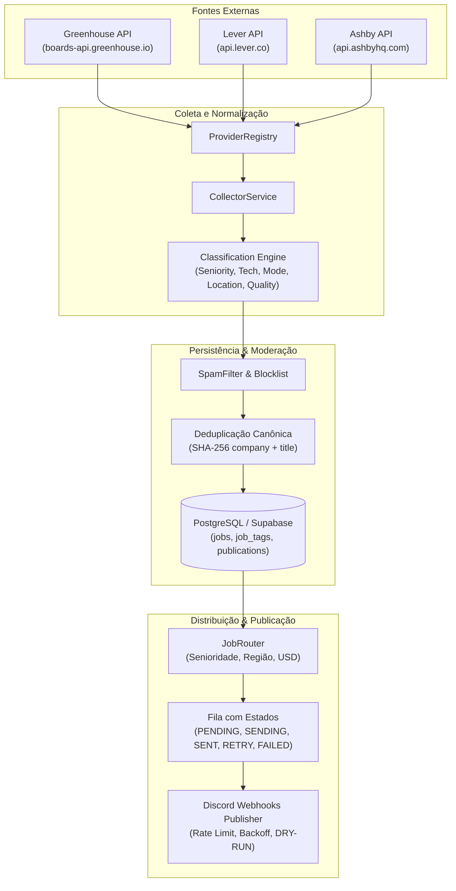

# Arquitetura do JobRadar v1.0

O **JobRadar** foi projetado seguindo princípios de **Clean Architecture**, **Separação de Preocupações (SoC)** e **Design Orientado a Domínio (DDD)**, priorizando alta confiabilidade operacional, idempotência estrita e resiliência contra falhas de rede.

---

## 1. Visão Geral do Fluxo de Dados



---

## 2. Camadas da Aplicação

### 2.1 Domain Layer (`src/domain/`)
- Contratos de dados imutáveis (`NormalizedJob`, `SourceConfig`, `DiscordChannelConfig`).
- Schemas Zod em tempo de execução para validação de entrada de APIs externas e payloads.
- Hierarquia de erros tipados (`AppError`, `NetworkError`, `RateLimitError`, `ProviderError`, `DatabaseError`).

### 2.2 Providers Layer (`src/providers/`)
- Interface comum `JobProvider`:
  ```typescript
  interface JobProvider {
    name: string;
    collect(source: SourceConfig): Promise<NormalizedJob[]>;
  }
  ```
- Clientes HTTP isolados para **Greenhouse**, **Lever** e **Ashby**.
- Tolerância a falhas:
  - Timeout nativo via `AbortController` (default: 10s).
  - Retentativas com backoff exponencial e jitter (3 tentativas).
  - Tratamento de HTTP 429 (`Retry-After`).
  - Proteção de memória contra payloads gigantes (limite de 15MB).

### 2.3 Classification Engine (`src/classification/`)
- **Seniority Classifier**: Reconhecimento determinístico de senioridade (`intern`, `junior`, `mid`, `senior`, `staff`, `unknown`) em português e inglês.
  - Prioridade no título.
  - Filtro negativo de falsos positivos na descrição (ex: `reporting to a senior`, `mentored by senior engineers`, `lead by example`).
- **Technology Detector**: Regex de fronteira (`\b`) para identificar linguagens, frameworks, bancos e ferramentas da nuvem sem falsos positivos (ex: `Java` vs `JavaScript`, `Go` isolado vs palavras comuns como `good` ou `go ahead`, `Rust` vs `trust`).
- **Work Mode Classifier**: Identificação de `remote`, `hybrid`, `onsite` e `unknown`, filtrando termos como `remote sensing` ou `no remote`.
- **Location & USD Classifier**:
  - Brasil, Brasil Remoto, LATAM e Internacional.
  - **Vagas em Dólar (USD)**: Exige evidência explícita comprovada no texto ou moeda declarada (evitando classificar falsamente menções em `R$`).
- **Quality Scorer**: Pontuação de 0 a 100 baseada na integridade, completude e consistência das informações.

### 2.4 Persistence Layer (`src/persistence/`)
- Driver nativo `pg` com pooling transacional, compatível com **Supabase Transaction Pooler** (porta 6543) e **Direct Connection** (porta 5432).
- **Idempotência**:
  - Chave única `(provider, provider_job_id)` com `ON CONFLICT DO UPDATE`.
  - Hash canônico `canonical_hash = SHA256(company + normalizedTitle)` para identificar vagas idênticas publicadas entre provedores diferentes.
- **Segurança**:
  - Webhooks nunca são salvos em texto puro no banco de dados. O banco armazena apenas a chave de variável de ambiente (`env_key`).
  - Row Level Security (RLS) habilitado em todas as tabelas no Supabase com acesso restrito a `service_role`.

### 2.5 Publisher & Moderation Layer (`src/publisher/` e `src/moderation/`)
- **Fila de Estados**:
  - `PENDING`: Aguardando janela de disparo.
  - `SENDING`: Em trânsito com lock.
  - `SENT`: Publicado com sucesso (registra `discord_message_id`).
  - `RETRY`: Falha temporária com backoff agendado.
  - `FAILED`: Esgotamento de tentativas (máx: 3).
  - `SKIPPED`: Descartada por moderação ou limite diário.
- **Formatação de Embeds**:
  - Sanitização de `@everyone`, `@here` e IDs de menção `<@&...>`.
  - Configuração estrita de `allowed_mentions: { parse: [] }`.
  - Truncamento conforme limites da Discord API (256 no título, 1024 em fields).
  - Cores temáticas por categoria.
  - Suporte total a `DRY_RUN` para homologação sem disparo real na rede.

---

## 3. Estratégia de Deduplicação e Recuperação de Desastres

1. **Falha de Rede após Recepção do Discord**:
   - Caso o Discord receba a mensagem mas a conexão caia antes de receber o HTTP 200, na próxima tentativa a publicação é enviada em `RETRY`. O sistema registra cada tentativa em `publication_attempts` com timestamp e código HTTP para rastreabilidade e auditoria.
2. **Ciclo de Coleta Concorrente**:
   - As migrações possuem constraints exclusivas (`uq_jobs_provider_job_id` e `uq_publications_job_channel`).
   - Apenas uma publicação é gerada por par de `(job_id, channel_id)`.
